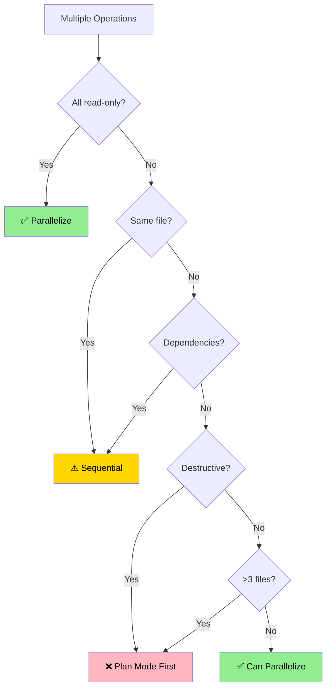

# Edit Tool Frameworks Reference

Extended decision trees, edge cases, conversion guide, and detailed examples.

---

## Table of Contents

- [Complete Decision Framework](#complete-decision-framework)
- [Context Execution Mode](#context-execution-mode)
- [Token Estimation Guidelines](#token-estimation-guidelines)
- [Edge Cases & Special Situations](#edge-cases--special-situations)
- [Tool Conversion Guide](#tool-conversion-guide)
- [Context Pollution Analysis](#context-pollution-analysis)
- [Bash Script vs Skill Wrapper](#bash-script-vs-skill-wrapper)
- [Parallelization Deep Dive](#parallelization-deep-dive)
- [Real-World Examples](#real-world-examples)
- [Fork vs Subagent](#fork-vs-subagent)
- [Proactive Audit](#proactive-audit-run-on-every-createedit)
- [Prompt-audit pass](#prompt-audit-pass)

---

## Context Execution Mode

Primary discriminator for tool design.

Sources: code.claude.com/docs/en/skills § Run skills in a subagent; code.claude.com/docs/en/sub-agents § Fork the current conversation (doc officielle, 2026-09-23; re-checked 2026-10-02).

Two distinct mechanisms share the word "fork": the skill frontmatter `context: fork` (isolated subagent, no history) and the conversation fork (Agent tool, full history). Never conflate them.

### Skill execution modes (frontmatter)

| Frontmatter | Runs in | Conversation history | Best for |
|-------------|---------|----------------------|----------|
| `context` absent (default) | Main conversation, inline | Full | Quick actions, interactive, depends on what was discussed |
| `context: fork` | New subagent of type `agent:` (omitted → `general-purpose`); SKILL.md content = its prompt | None, instructions must stand alone | Self-contained task with explicit steps, heavy output, research where parent state is irrelevant or would bias |

- `context:` has one documented value: `fork`. `main`, `subagent`, `inherit` are undocumented, silently ignored = inline (tested CC 2.1.287); never emit them.
- Despite the name, `context: fork` does NOT fork the conversation. Task depends on history → inline skill, optionally spawning conversation forks (below).
- `agent:` selects the subagent type (Explore, Plan, general-purpose, custom from `.claude/agents/`); omitted → `general-purpose`. Explore and Plan skip CLAUDE.md and git status.
- `model:` with `context: fork` sets the forked subagent's model.
- Runs in background by default (v2.1.218+). It still waits for the result, even without `background: false`, in cases like: non-interactive mode (`-p`, Agent SDK); `CLAUDE_CODE_DISABLE_BACKGROUND_TASKS=1`; an earlier invocation of the same skill still running; a scheduled task firing with the skill as its prompt. A backgrounded `context: fork` skill gets the narrower background-subagent tool set: its subagent is a regular agent type, so the exemption for conversation forks does not cover it. Its edits bypass checkpoints (`/rewind` does not undo them). Steps need a tool outside that set → `background: false`, which waits in the invoking turn and keeps the full tool set.
- Guidelines without a task + `context: fork` → subagent gets no actionable prompt, returns nothing useful.

### Spawn mechanisms (from a skill body, not frontmatter)

| | Conversation fork | Typed subagent |
|---|---|---|
| Invocation | `Agent({subagent_type: "fork", prompt})`; user: `/subtask <task>` | `Agent({subagent_type: "<type>", prompt})` |
| Context | Full conversation history; same system prompt, tools, model as main session | Fresh, prompt you pass + definition file |
| Prompt cache | Shared with main session | Separate |
| Per-agent config | None | `model`, `tools`, memory, `maxTurns` from definition |
| Nesting | A fork can't spawn further forks | Per `CLAUDE_CODE_MAX_SUBAGENT_SPAWN_DEPTH` |

Fork mode: on by default in interactive sessions (v2.1.232+), off by default in `-p` and the Agent SDK. `CLAUDE_CODE_FORK_SUBAGENT=1` turns it on there (and on pre-v2.1.232), `=0` turns it off everywhere. `/subtask` works either way. Omitting `subagent_type` gives general-purpose, never a fork.

### Decision Tree

See `SKILL.md` for canonical Mermaid.

### When to Use a Conversation Fork (spawned from an inline skill)

✅ Fan-out parallel reasoning (N approaches from the same starting point) · ✅ Side task that needs the full history (re-briefing too costly) · ✅ Shares prompt cache with main session
❌ Per-agent model/memory/tools needed · ❌ Team Protocol required · ❌ Named persona identity · ❌ Debiasing (a fork carries the parent's reasoning; use a typed subagent or `context: fork`)

### When to Use `context: fork` or a Typed Subagent

✅ Verbose output >2000 tokens · ✅ Deep codebase analysis, parent state irrelevant · ✅ Long-running analysis · ✅ Debiasing (no parent reasoning) · ✅ Per-agent config (model downgrade, scoped memory, narrower tools) via typed subagent or `agent:` custom type · ✅ Named persona / Team Protocol / SendMessage via typed subagent

### When to Use Inline (default)

✅ Quick ops · ✅ Context-dependent · ✅ Frequent invocation (5+/session) · ✅ Interactive

### Fork Spawning Contract

An inline skill that spawns conversation forks MUST include in its runtime instructions:

1. **Invocation**: Call `Agent` with `subagent_type: "fork"`; omitting it gives general-purpose, not a fork. Requires fork mode (see above).
2. **Restate specifics**: include target/constraint/decision under review in the directive
3. **Batch parallel**: send N forks in one tool-use block (each fork reuses the main session's prompt cache)
4. **Don't peek**: never Read the fork's `output_file`
5. **Directive style**: prompt = what to do, not briefing (parent ctx already loaded)

The spawning skill must be inline: a `context: fork` skill already runs as an isolated subagent without history.

Example fork spawn (inside an inline skill body):

    Agent({
      subagent_type: "fork",
      name: "alt-approach-b",
      description: "Explore approach B",
      prompt: "Target decision: <RESTATE>. Develop approach B from current state. Report <300 words: verdict, evidence, risks."
    })

### Counterexample — when fork does NOT fit

- **`philosopher/council`**: 5 parallel philosophers, independent. Fan-out mechanics fit fork BUT per-agent model (haiku qualification + opus deliberation) + scoped memory require a typed subagent.
- **`philosopher/encounter` / `philosopher/dialogue`**: SendMessage + Team Protocol + named persona → typed subagent.

Rule: per-agent model/memory/tools OR named persona OR Team Protocol OR debiasing → typed subagent, even when fan-out fits fork.

---

## Complete Decision Framework

### 7-Axis Analysis

#### Axis 1: Execution Type (Cost & Determinism)

| Type | Characteristics | Tool Choice |
|------|----------------|-------------|
| **Pure deterministic** | Sequential shell commands, no decisions | Bash Script |
| **Deterministic + AI** | Scripts exist, AI decides when/how | Skill with scripts/ |
| **Single AI operation** | One response, simple logic | Skill (user-triggered or auto) |
| **Multi-step AI** | Autonomous reasoning across steps | Sub-Agent |
| **Capability enhancement** | Extends Claude's abilities | Skill |

#### Axis 2: Invocation Pattern

| Pattern | User Action | Frontmatter |
|---------|-------------|-------------|
| **Dual-invocable** (default) | Both `/skill-name` and model auto-invoke | No special frontmatter needed |
| **Manual-only** (rare) | Only `/skill-name` | `disable-model-invocation: true` |
| **Programmatic** | Called by other tools | Sub-Agent (Agent tool) |

#### Axis 3: Token Budget (Pollution Cost)

House heuristic for total tool content, not an official limit. Official SKILL.md ceiling: <500 lines (doc officielle, 2026-09-23).

| Range | Implication | Tool Choice |
|-------|-------------|-------------|
| **0 tokens** | Script executed, not read | Bash Script or Skill+scripts/ |
| **<500 tokens** | Acceptable pollution | Skill (ideal) |
| **500-2000 tokens** | Use progressive disclosure | Skill + reference.md |
| **>2000 tokens** | Needs isolation | Sub-Agent or `context: fork` |

**Estimation Tips:**
- Count prose, not code blocks (code is efficient)
- Tables ~50% more efficient than prose
- Mermaid diagrams ~40% more efficient than text descriptions
- Use `wc -w file.md` then multiply by 1.3 for rough token count

#### Axis 4: Context Strategy

| Need | Rationale | Tool Choice |
|------|-----------|-------------|
| **Main context access** | Needs conversation history | Skill (inline, no `context:`) |
| **Parallel fan-out w/ shared history** | N approaches from current state | Inline skill spawning conversation forks |
| **Isolated exploration** | Research without pollution, debiasing | Skill (`context: fork`) or Sub-Agent |
| **Minimal pollution** | Concise, high-value capability | Lean skill (SKILL.md well under 500 lines) |
| **Zero pollution** | Execution only | Bash Script |

#### Axis 5: Frequency & Justification

| Frequency | Per Session | Frontmatter | Tool Choice |
|-----------|-------------|-------------|-------------|
| **Very high** | 10+ | default (auto-invoke) | Skill |
| **High** | 5-9 | default (auto-invoke) | Skill (if lean) |
| **Medium** | 2-4 | default (dual-invocable) | Skill |
| **Low** | 1 | default (dual-invocable) | Skill |
| **Rare** | <0.1 | — | Direct Request |

**Context Pollution Math:**
- Skill at 400 tokens, used 10x/session = 4000 token "cost"
- But only loaded once when triggered
- Justify if saves >4000 tokens of repeated instructions

#### Axis 6: Script Wrapping Requirement

| Scenario | Problem | Solution |
|----------|---------|----------|
| **Pure scripts** | No AI needed | Bash Script |
| **Scripts + timing** | AI decides when to run | Skill with scripts/ |
| **Scripts + parameters** | AI generates args | Skill with scripts/ |
| **Scripts + orchestration** | Complex sequencing | Skill or Sub-Agent |

#### Axis 7: Write Operations (Parallelization)

| Operation | Risk | Guidance |
|-----------|------|----------|
| **Read-only** | None | ✅ Parallelize freely |
| **Write (independent)** | Conflicts | ⚠️ Sequential OR Plan Mode |
| **Write (dependent)** | Ordering | ⚠️ Careful sequencing |
| **Destructive** | Data loss | ❌ Plan Mode mandatory |

---

## Token Estimation Guidelines

### Quick Estimation

```bash
# Word count method
wc -w SKILL.md
# Multiply by 1.3 for token estimate

# Character count method (rough)
wc -c SKILL.md
# Divide by 4 for token estimate
```

### Content Type Multipliers

| Content Type | Tokens vs Words | Example |
|--------------|-----------------|---------|
| **Prose paragraphs** | 1.5x | "This section describes the process of..." |
| **Bullet lists** | 1.2x | "- Step one\n- Step two" |
| **Tables** | 0.8x | Markdown tables (structure = tokens) |
| **Code blocks** | 0.7x | Syntax highlighting efficient |
| **YAML** | 0.6x | Key-value pairs compress well |
| **Mermaid** | 0.5x | Structure encoded in syntax |

### Target Budgets

```yaml
Skill SKILL.md:
  Limit: <500 lines (doc officielle, 2026-09-23); move detail to references/
  Listing: description + when_to_use combined, truncated at 1536 chars (doc officielle, 2026-09-23); key use case first
  House target: as lean as possible; token counts here are estimates, not limits

Skill reference.md:
  Typical: 1000-3000 tokens
  Maximum: No hard limit (loaded on-demand)

Agent .md:
  Typical: 300-1000 tokens (system prompt, house heuristic)
  Maximum: No hard limit (isolated context)
```

---

## Edge Cases & Special Situations

### Case 1: "I want a skill that wraps multiple workflows"

**Analysis:**
- Token budget likely >1000 (multiple workflows)
- Violates single-responsibility principle

**Solution:**
- Create individual skills for each capability
- Or create orchestrator skill that delegates (like edit-tool!)

### Case 2: "Prevent this tool from auto-invoking"

**Analysis:**
- Rare case where auto-invoke is undesirable (e.g. destructive operations)

**Solution:**
- Add `disable-model-invocation: true` to frontmatter
- This is the exception, not the default

### Case 3: "This skill is too verbose (SKILL.md near 500 lines)"

**Solutions:**
1. **Progressive disclosure**: Move details to reference.md
2. **Split into multiple skills**: If multiple capabilities
3. **`context: fork`**: If the task is self-contained and needs no conversation history (isolated subagent)
4. **Conversation forks from an inline body**: If parallel fan-out needs the full history (`subagent_type: "fork"`)
5. **Convert to Agent**: If >2000 tokens, exploratory, or needs per-agent config

### Case 4: "I need a skill that runs complex scripts"

**Solution:**
```
skill-name/
├── SKILL.md (instructions for when/how to use scripts)
├── scripts/
│   ├── analyze.py
│   ├── transform.sh
│   └── validate.py
└── reference.md (script documentation)
```

### Case 5: "Should this be a skill or use existing Agent tool?"

**Decision Tree:**
```
Is there an existing agent? (Explore, Plan, etc.)
├─ Yes → Use Agent tool (no new skill needed)
└─ No → Create skill (with appropriate context mode)
```

### Case 6: "Skill for one project vs all projects"

- `.claude/skills/` → Current project only
- `~/.claude/skills/` → All projects (rare, use plugins instead)
- Plugin `skills/` → Plugin distribution

---

## Tool Conversion Guide

### Legacy Command → Skill

**When:** Migrating existing commands to unified skill format.

**Process:**
1. Create skill directory: `skills/tool-name/`
2. Add unified frontmatter (see skill-guide.md § Unified Frontmatter Specification)
3. Ensure `description` has trigger keywords (enables model auto-invoke)
4. Move verbose content to `reference.md`
5. Keep SKILL.md <500 lines and description + when_to_use ≤1536 chars (doc officielle, 2026-09-23)
6. Test trigger still works

**Frontmatter transformation:**
```yaml
# BEFORE (legacy command)
description: Brief description
allowed-tools: [Tool1, Tool2]
argument-hint: pattern
model: sonnet

# AFTER (skill)
name: tool-name
description: Brief description. Use when [triggers].
allowed-tools: [Tool1, Tool2]
argument-hint: pattern
model: sonnet
# No context: field = inline (default); context: fork only for isolated self-contained tasks
# Dual-invocable by default
```

### Skill → Agent

**When:** Token budget >2000, needs isolated context, complex multi-step exploration.

**Process:**
1. Create `.claude/agents/agent-name.md`
2. Add frontmatter: `name`, `description`, `tools`, `model`
3. Convert instructions to system prompt (2nd person → role-based)
4. Restrict tools to minimum needed
5. Remove references to conversation history

### Bash Script → Skill Wrapper

**When:** Script works but AI needs to decide when/how to use it.

**Process:**
1. Create skill: `skill-name/`
2. Move script to `scripts/` subdirectory
3. Write SKILL.md: when to invoke, how to generate parameters, how to interpret output
4. Keep script pure (no AI logic in script)

---

## Context Pollution Analysis

### What is Context Pollution?

Every skill's SKILL.md body is loaded when triggered and remains in context. This competes with conversation history, other skills, file contents, and user requests.

### Pollution Impact Formula

```
Impact = TokenCount × LoadFrequency × SessionDuration
```

### Minimizing Pollution

**Technique 1: Progressive Disclosure**
```
SKILL.md (300 tokens) → Always loaded when triggered
reference.md (2000 tokens) → Loaded only if Claude reads it
scripts/ (0 tokens) → Executed, never loaded
```

**Technique 2: Token Efficiency**
- Tables over prose (50% savings)
- Mermaid over text (40% savings)
- Inline examples over blocks
- Front-load critical info

**Technique 3: Precise Triggers**
- Specific triggers = loads only when needed
- Generic triggers = loads too often = more pollution
- Example: "Use for .xlsx files" (good) vs "Use for documents" (bad)

**Technique 4: Context Mode**
- `context: fork` = only the result returns to main ctx (isolated subagent, no conversation history, background by default)
- Conversation forks spawned from an inline body = only results return; each fork carries full history and shares the prompt cache
- `context: fork` for research/analysis; conversation forks for parallel fan-out from current state

### When Pollution is Acceptable

✅ **High-value capabilities**: >2000 tokens worth of procedural knowledge, used 5+ times/session
✅ **Zero-inflation skills**: Mostly references `scripts/` (0 token execution), SKILL.md ~200-300 tokens
❌ **Unacceptable**: >1000 token skill used 1x per session — use progressive disclosure (reference.md), `context: fork` (isolation), or conversation forks (fan-out)

---

## Bash Script vs Skill Wrapper

### Decision Matrix

| Characteristic | Bash Script | Skill Wrapper |
|----------------|-------------|---------------|
| **Operations** | Purely deterministic | AI decides when/how |
| **Parameters** | Hardcoded or user-provided | AI-generated |
| **Context** | None | Minimal (decision logic) |
| **Reusability** | Limited to script use cases | Flexible invocation |
| **Token cost** | 0 | ~200-400 (wrapper logic) |

### When Scripts Can't Solve It

**Scenarios requiring AI:**
1. **Ambiguous input**: "Make this image look better"
2. **Context-dependent**: "Fix the test failures"
3. **Creative tasks**: "Write API docs"
4. **Multi-file coordination**: "Refactor authentication"

**These need:** Skill or Agent, not script wrappers

---

## Parallelization Deep Dive

### Safe Parallelization Rules

#### ✅ Always Safe: Read Operations
```markdown
[Read src/auth.js]
[Read src/user.js]
[Grep "function" --output_mode content]
[Glob "**/*.config.js"]
```

#### ⚠️ Sometimes Safe: Independent Writes
Safe if different files, no shared state, no dependencies.

#### ❌ Never Parallel: Destructive Operations
Always Plan Mode first: deleting files, renaming, refactoring >5 files, breaking changes.

### Parallelization Decision Tool



---

## Real-World Examples

### Example 1: Test Coverage Analyzer (Auto-invoked Skill)

**Request:** "I need something to check test coverage and show gaps"

**Analysis:**
- Pollution cost: ~400 tokens → Low
- Frequency: 3-5x/session → High
- Context: Needs main (recent changes)

**Decision:** `✅ SKILL because: ~400 tokens → low pollution, 5x/session → auto-invoke justified`

```
test-coverage/
├── SKILL.md (400 tokens - when to check, how to report)
└── scripts/parse_coverage.py (0 tokens - executed)
```

### Example 2: API Documentation Generator (User-triggered Skill)

**Request:** "Build a tool that generates API docs from code comments"

**Analysis:**
- Pollution cost: ~1500 tokens → Medium (use progressive disclosure)
- Frequency: 1-2x/session → Low
- Invocation: User triggers when docs needed

**Decision:** `✅ SKILL because: ~300 token SKILL.md + reference.md for progressive disclosure, 1-2x/session, dual-invocable`

```
generate-api-docs/
├── SKILL.md (~300 tokens - when to use, output format)
└── reference.md (~1200 tokens - parsing rules, templates, examples)
```

### Example 3: Codebase Analyzer (Sub-Agent)

**Request:** "Explore the codebase and explain architecture"

**Analysis:**
- Pollution cost: >3000 tokens → High
- Frequency: 1x/session
- Context: Doesn't need conversation history

**Decision:** `✅ SUB-AGENT because: >3000 tokens, complex exploration, isolated context needed`

### Example 4: Deploy to Vercel (User-triggered Skill)

**Request:** "Make a slash command for deploying to Vercel"

**Analysis:**
- Pollution cost: ~600 tokens → Medium
- Frequency: 1-2x/session → Low
- Invocation: User manually triggers

**Decision:** `✅ SKILL because: progressive disclosure keeps SKILL.md lean (<500 lines), dual-invocable, trigger keywords in description`

```yaml
# Frontmatter
name: deploy-vercel
description: Deploy to Vercel. Use when "deploy to vercel", "vercel deploy".
argument-hint: [environment]
# Dual-invocable by default
```

---

## Summary Cheat Sheet

```yaml
Choose BASH SCRIPT when:
  ✅ Purely deterministic shell operations
  ✅ No AI decision-making needed
  ❌ NOT: Needs AI to decide when/how/what

Choose SKILL (auto-invoked) when:
  ✅ Lean SKILL.md (~500 tokens = pollution heuristic, not a size rule)
  ✅ Used 5+ times per session
  ✅ Auto-invoke makes sense
  ✅ Specific capability
  ❌ NOT: Verbose, rare, or user-triggered

Choose SKILL (with progressive disclosure) when:
  ✅ Content exceeds a lean SKILL.md
  ✅ Keep SKILL.md <500 lines (doc officielle, 2026-09-23), verbose content in reference.md
  ✅ Any frequency (dual-invocable by default)
  ✅ Workflow with steps

Choose SKILL (context: fork) when:
  ✅ Self-contained task with explicit steps, no conversation history needed
  ✅ Research, exploration, heavy analysis, debiasing
  ✅ Verbose output that would pollute main context
  ❌ NOT: guidelines without a task; needs what was discussed
  Frontmatter: context: fork (+ agent: <type>, optional model:, background: false to wait)

Choose INLINE SKILL spawning conversation forks when:
  ✅ Parallel fan-out from the current conversation state
  ✅ Prompt cache shared with main session
  ❌ NOT: per-agent model/memory/tools/persona/Team Protocol, debiasing
  Body: Agent({subagent_type: "fork", ...})

Choose SUB-AGENT when:
  ✅ >2000 tokens AND complex exploration
  ✅ Multi-step autonomous reasoning
  ✅ Needs full isolation
  ❌ NOT: Needs main conversation context

Choose DIRECT REQUEST when:
  ✅ One-off task, <1 per 10 sessions
  ✅ Simple enough to ask inline
  ❌ NOT: Worth building a tool for
```

---

## Fork vs Subagent

Spawn mechanisms from a skill body (Agent tool), not the `context:` frontmatter. See [Context Execution Mode](#context-execution-mode) for `context: fork`, which is neither: it runs the whole skill as an isolated subagent.

| | Conversation fork | Typed subagent |
|---|---|---|
| Parent context | Full conversation history, same system prompt/tools/model | None, fresh prompt + definition |
| Invocation | `Agent({subagent_type: "fork", prompt,...})` | `Agent({subagent_type: "<type>", prompt,...})` |
| Prompt style | Directive — restate current-turn facts | Self-contained briefing |
| Per-agent config | ❌ none | ✅ tools/model/memory/maxTurns |
| Prompt cache | Shared with main session | Separate |

**Fork rules** (skill body MUST enforce): `subagent_type: "fork"` (omitting it gives general-purpose) · restate target/constraint/decision · batch parallel in one tool-use block · NEVER Read output_file.

**Keep typed subagent when ANY**: (1) per-agent model · (2) scoped memory · (3) narrower tool allowlist · (4) SendMessage/Team Protocol · (5) named persona (`subagent_type: plugin:persona`) · (6) debiasing (fork carries parent reasoning).

Cases: `philosopher/council` (model+memory), `philosopher/encounter`+`dialogue` (Team Protocol).

---

## Proactive Audit (run on every create/edit)

**Check 1 — frontmatter compliance** (doc officielle, 2026-09-23)
- `context:` absent or `fork` — any other value (`main`, `subagent`, `inherit`) is undocumented → flag. `main` → remove the field. `subagent` → `context: fork` (+ `agent:` if a type was intended). Body expects parent history → remove `context:`, spawn conversation forks from the body.
- `agent:` or `background:` without `context: fork` → flag (no effect).
- `context: fork` + body is guidelines without a task → flag (subagent returns nothing useful).
- Body spawns forks without `subagent_type: "fork"` → flag (gets general-purpose).
- SKILL.md ≥500 lines → flag, move detail to references/. description + when_to_use >1536 chars → flag (truncated in listing).

**Check 2 — fit check** (recommend change, ask confirm)
- `context: fork` declared, task depends on conversation history → inline (+ conversation forks if fan-out)
- Inline skill spawns conversation forks, needs per-agent config/persona/Team Protocol or debiasing → typed subagent
- Inline skill spawns typed subagents for generic fan-out from current state (no persona, no cross-talk, no per-agent config) → conversation forks
- Inline skill, self-contained task, body spawns Agent >2×/invocation → consider `context: fork`

### Prompt-audit pass

Complements Checks 1-2 (structural); does not replace them.

- **Trigger**: Optimize mode; creation of a non-trivial skill or agent. Skip for small Modify edits (loading claude-api costs tokens).
- **Scope**: skill = SKILL.md + `references/` + `description`/`when_to_use`; agent = system prompt body + `description`.
- **Target model**: audited tool's frontmatter `model:`; absent or `inherit` → current session model.
- **Pass 1 — dated-pattern pass**: invoke `/claude-api prompt-audit` with the scope and target model above. It returns a report and a diff covering pressure language, fossils, over-specification and restated defaults. Call it by skill name only: its bundled file path is versioned per Claude Code release and breaks on upgrade; do not copy its content here either (goes stale).
- **Pass 2 — edit-tool-specific pass** (prompt-audit does not cover these): tool-type fit, Checks 1-2 above, fork spawning contract, SKILL.md → references/ split, description + when_to_use triggers within 1536 chars, pollution budget, preservation of existing functions. Keep fragile-operation guards (e.g. "never Read output_file") even if pass 1 flags them as pressure language.
- **Fallback**: claude-api skill unavailable → say so, run pass 2 only.
- **Consent**: present both diffs; apply only what the user accepts.
